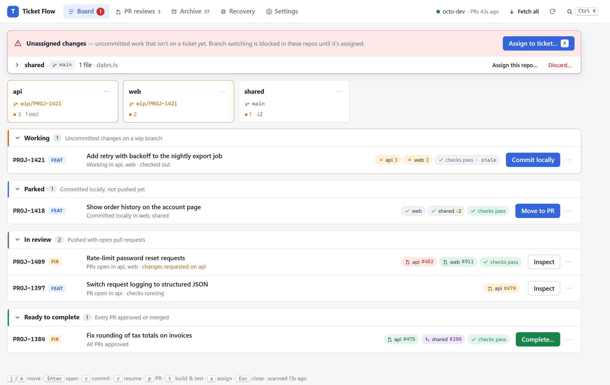
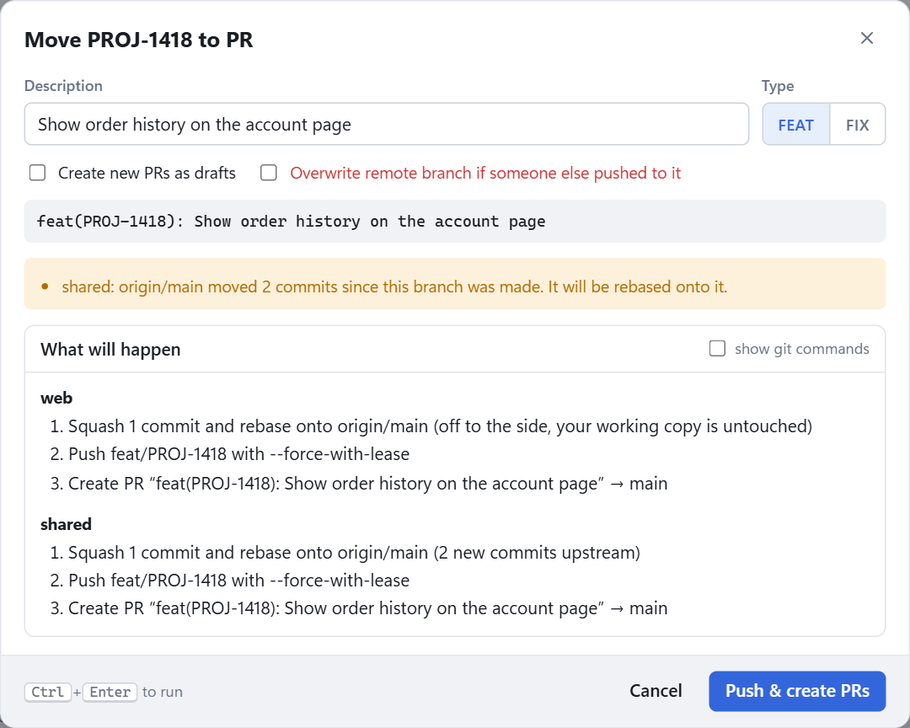
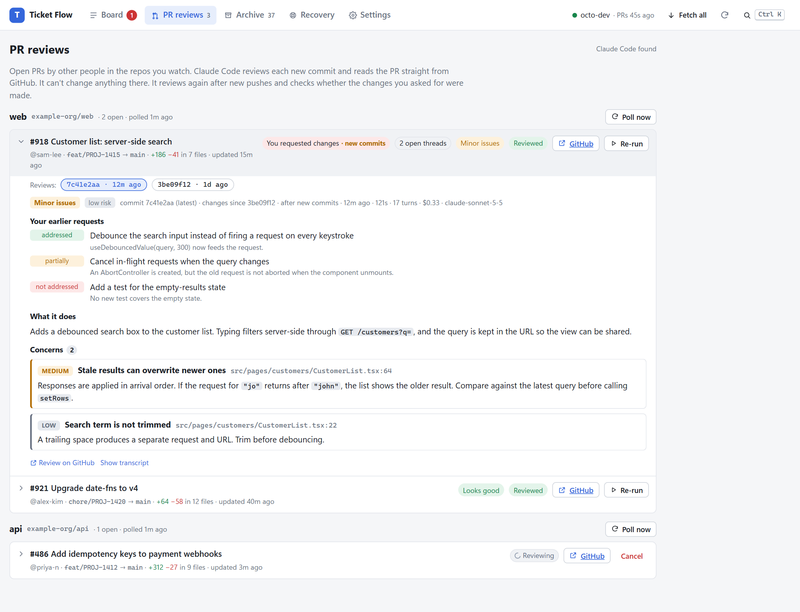
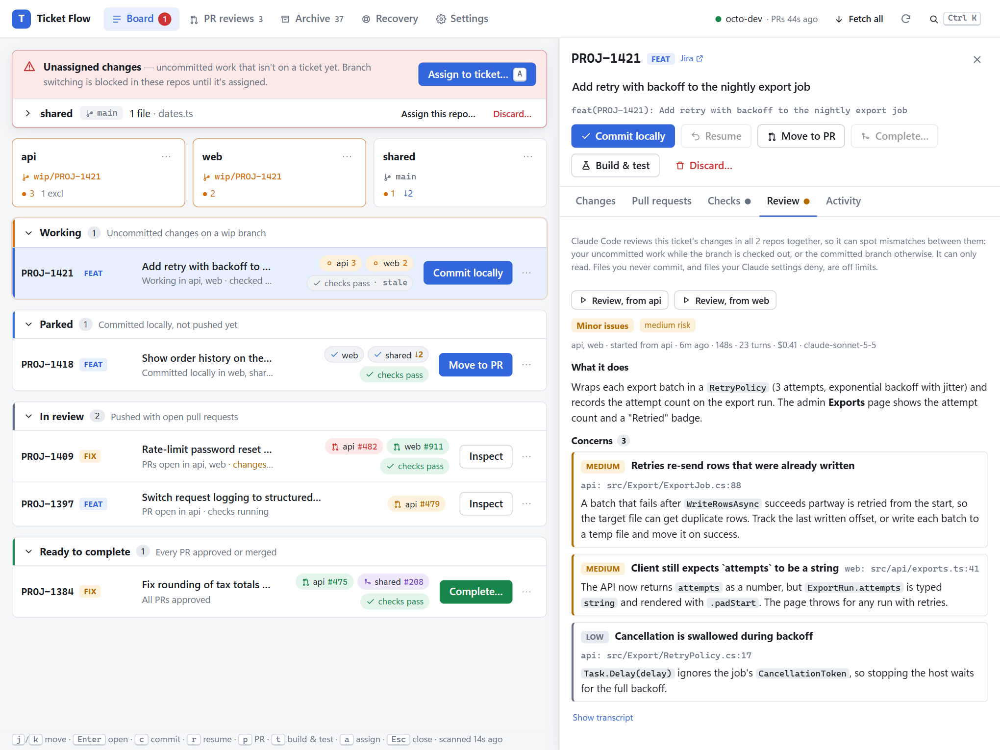

# Ticket Flow

*(repo: `ai-built-ticket-flow`. Built with Claude Code.)*

A local tool for working on several tickets at once across several repos. You never switch branches by hand. Each ticket is a set of `wip/<key>` branches, one per repo. The tool moves each ticket through these stages:

**Unassigned → Working → Parked → In review → Ready → Completed (archive)**

Every action shows a step-by-step preview before it runs. Anything it discards or deletes is backed up first and can be restored.

Ticket keys look like `PROJ-1234`. Jira links are built in, but any tracker that uses `KEY-123` style keys works.



## Run it

```
start.cmd        # Windows
./start.sh       # macOS / Linux
```

The start script builds the UI the first time, starts the server on `http://127.0.0.1:5199` and opens your browser through a one-time sign-in link. The server only answers on loopback. The link sets a cookie, and API calls without that cookie are rejected. If you open the page later and see the "Open Ticket Flow from its link" screen, use the link printed in the console window.

Requirements:

- .NET 10 SDK
- Node 18+ (to build the UI)
- git
- the GitHub CLI (`gh`), logged in to the account that should author the PRs
- optional: [Claude Code](https://claude.com/claude-code) (`claude`), for the PR and ticket reviews

Set the `gh` account under Settings → GitHub account.

Ticket Flow is developed and used on Windows. The .NET server, git handling and UI are cross-platform, and macOS/Linux are supported on a best-effort basis (`start.sh`, `open`/`xdg-open` for **Open folder**). Paths below use the Windows names: `%APPDATA%` and `%LOCALAPPDATA%` are .NET's ApplicationData and LocalApplicationData folders, which are under `~/.config` and `~/.local/share` on Linux.

On first run, open **Settings**:

1. Add your repos by path, or use **Find repos in folder**. Their order is the merge order that **Complete** uses.
2. Check **Never commit these files**. By default Ticket Flow reads the deny regex from the Claude Code `PreToolUse` hook in `~/.claude/settings.json` (`grep -qiE '<regex>' && … "deny"`) on every scan. Files Claude may not touch are therefore never committed or discarded, and the list follows any edit to the hook. You can add extra globs. A live preview shows which of your current changes would be excluded. Turn the hook off with `"excludeFromClaudeHook": false`, or point `claudeSettingsPath` at another settings file.
3. Optionally set the Jira browse URL.

## How it works

| You do | Ticket Flow does |
|---|---|
| Edit files on `master` | Shows them as **Unassigned** (red banner). Switching branches is blocked in that repo until they're assigned. |
| **Assign to ticket…** (`a`) | Takes a backup, then runs `git switch -c wip/PROJ-1234` in every selected repo. If PROJ-1234 is already in flight, it offers to add the changes to it or to create `PROJ-1234_2`. Each `_n` suffix is unique across every repo, on local and remote branches. |
| **Commit locally** (`c`) | Makes one commit, `feat(PROJ-1234): description`, that never includes excluded files. Then it switches back to `master` and fast-forwards it from origin. |
| **Resume / Re-open** (`r`) | Switches to the ticket's branches and undoes the commit, so the changes are uncommitted again. If another ticket has work in progress in that repo, it is committed first ("auto-park"). |
| **Move to PR / Update PRs** (`p`) | Squashes and rebases onto `origin/master` without touching your working copy. Then it pushes `feat/PROJ-1234` with `--force-with-lease` and creates or updates the PR (title only). It refuses if someone else pushed to the branch, unless you tick "Overwrite". |
| **Complete…** | Re-checks every PR. In configured repo order it squash-merges each one, pinned to the expected head sha, and deletes its remote branch. Only after every PR is merged does it delete the local `wip/` branches. Then it pulls `master` and archives the ticket. |
| **Discard…** | Backs up first. Deleted branches are kept under `refs/ticket-flow/trash/…` and can be restored from **Recovery**. |
| **Build & test** (`t`) | Builds and runs the unit tests of every repo in the ticket, in your working copy. See below. |

Every action opens a preview like this first. Nothing runs until you confirm it:



**Excluded files** (your local config) travel with your working copy byte-for-byte on every switch. If the committed version on the target branch differs, your copy is kept and the tool warns you so you can review it.

**Rebase conflicts**: the "Move to PR" rebase runs off to the side. On a conflict nothing is pushed. **Rebase in working copy** (in the ticket's Changes tab) then leaves the repo mid-rebase so you can fix files in your editor and press **Continue** on the repo card.

**Backups** are commits built with a temporary index, so your files and index are never touched. They are stored under `refs/ticket-flow/backups/` and are local only (never pushed). **Fetch all** prunes them after the retention period.

**Build & test** works only on the active ticket, meaning one whose `wip/` branches are checked out in all of its repos (resume it first otherwise). It runs in your working copy, one repo at a time: the build first, then the unit tests (skipped if the build fails).

- **Other actions wait.** While it runs, every other action is blocked, so no branch can switch under the build. The banner and the ticket's **Checks** tab both show live output and a **Cancel** button. Cancel kills the whole process tree. Each command also stops after the timeout set in Settings (30 min by default).
- **What runs in each repo** (Settings shows what was detected for each repo):
  - .NET: `dotnet build` of the shallowest `.sln`/`.slnx`, then `dotnet test --no-build` for each unit test project in that solution. Projects named `…IntegrationTests`, `…E2E.Tests`, `…PerformanceTests`, `…Benchmarks` and so on don't run. A `global.json` that opts into Microsoft.Testing.Platform gets the `--project` syntax.
  - Node: `npm`/`yarn`/`pnpm` (chosen from the lockfile) runs the `build` and `test` scripts in the root `package.json`. `node_modules` must already be installed.
  - Per repo you can type your own build or test command (run with `cmd /c` on Windows or `/bin/sh -c` elsewhere, in the repo root), or `none` to skip that step.
- **The result** is kept per ticket. It shows as a chip on the ticket row (*checks pass* / *checks fail*), and in the **Checks** tab with failing tests, their assertion messages, compiler errors and the full output of each command. You also get a desktop notification when it finishes.
- **Staleness.** The result is marked *stale* once the ticket's code changes. It stays current through **Commit locally**, because the committed branch's git tree is compared with the tree that was tested.

## PR reviews (other people's PRs)

The **PR reviews** page lists the open PRs other people have in the repos you watch. Claude Code reviews each one and shows the result there.



- **Turn it on per repo:** tick **Review others' PRs** under Settings → Repositories. Only those repos are polled.
- **When it polls:** on the same tick and interval as the PR status poll. **Poll now** on a repo's section polls just that repo right away.
- **What gets reviewed:** every new head commit, once. A commit that has already been reviewed isn't reviewed again unless you press **Re-run**. A failed or cancelled review is also retried only by hand. Drafts wait until they're marked ready. PRs opened by bots (dependabot etc.) follow the **Bot PRs** setting: **Hidden** (the default) leaves them out of the list entirely, **Manual** lists them for **Review now**, and **Auto** reviews them like any other PR. Reviews run one at a time, never through the op queue, so they don't block your own actions.
- **What you get:** what the change does, a verdict and risk level, and concerns with their severity and file:line. Each PR has a link to its **Files changed** page on GitHub. You also get a desktop notification when a review finishes.
- **After you request changes:** when new commits arrive, Claude is given your review comment, your inline threads (with the replies) and a diff since the commit you reviewed. It reports whether each of your requests was **addressed / partially / not addressed / unclear**, then reviews everything else again.
- **How Claude runs:** `claude -p` runs headless in `%LOCALAPPDATA%\ticket-flow\pr-reviews\<owner>-<repo>-<n>\`. There's no local checkout. Claude reads the PR from GitHub, and only through a generated `pr.sh` that makes GET requests for that one PR. The settings are:
  - `--tools Bash`, with only `./pr.sh` allowed
  - `--permission-mode dontAsk`, so anything else is denied instead of prompted
  - `--setting-sources local`, so your user settings' allow rules (e.g. `gh api *`) don't apply
  - `--strict-mcp-config` and `--no-session-persistence`

  Claude can't comment, approve, merge or push. `gh` runs as the GitHub account set in Settings. The prompt (`prompt.md`), the helper and each run's raw log are kept in that folder, and **Show transcript** shows a readable version.
- **Settings → PR reviews:** the claude.exe path (found automatically on PATH, in `~/.local/bin` or in the VS Code extension), model, timeout, maximum USD per review, Bot PRs and extra review instructions. Reviews use your Claude Code plan.
- **Where results live:** `pr-reviews.json` keeps the last 8 reviews per PR. They are dropped once the PR is no longer open.

### Reviewing your own ticket

You can review your own ticket at any point while it still has a local `wip/` branch: while you're working on it, after a local commit, or while it's in review. Press **Review** on any repo in the ticket's Changes tab, or use the drawer's **Review** tab. One review covers **every repo of the ticket together**, so it can catch mismatches between them (API vs. client, shared models, messages). The repo you started from is looked at first.



- **What it reviews:** Ticket Flow snapshots each repo's changes into `pr-reviews\ticket-<KEY>\`: a diff against the merge base, and the ticket's version of each changed file. A checked-out repo includes your uncommitted work; a repo that isn't checked out uses its committed branch. Files you never commit are left out. Binary files and files over 512 KB are skipped. Snapshots wait for any running action to finish first.
- **What Claude can do:** only **Read, Grep and Glob**, with no Bash, over the snapshot and the ticket's repo folders (for surrounding code). Your user Claude settings are loaded, so your deny rules and protected-file hook still apply. On top of that, each repo gets absolute deny rules for your "never commit" globs and for your `Read(**/…)` deny rules, because relative rules don't reach those folders.
- **When it's stale:** the result is marked *stale* once the code changes, in the same way Build & test results are. A new run checks whether each concern from the previous run was fixed. Reviews are dropped when the ticket is completed or discarded.
- **Live test:** `TICKETFLOW_LIVE_CLAUDE=1 dotnet test --filter Live_review` runs a real Haiku review of a temporary ticket. It checks that the excluded file can't be read.

Keyboard: `Ctrl+K` command palette · `j`/`k` move · `Enter` open · `Esc` close · `c` commit · `r` resume · `p` PR · `t` build & test · `a` assign. Deep link to a ticket: `/#PROJ-1234`.

## Where state lives

Everything in flight comes from git, so using git by hand alongside the tool is fine:

- Ticket description and type: `branch.wip/<key>.description` and `.ticketflowType` in each repo's `.git/config`.
- Last pushed sha and remote branch name: `.ticketflowPushed` and `.ticketflowRemote` in the same place.
- Config: `%APPDATA%\ticket-flow\config.json`. It's personal (your repo paths, GitHub account, Jira URL) and lives outside the repo, so it's never committed. On first run it's created from the checked-in [`config.example.json`](config.example.json), without the example's placeholder repos and Jira URL. Edit it in Settings, or by hand while the server is stopped. The example shows every field; anything you leave out takes the default shown there.
- Archive, op journal, trash index and login token: `%LOCALAPPDATA%\ticket-flow\`
- Latest Build & test result per in-flight ticket: `checks.json` in the same folder, with each command's full output under `check-logs\<key>\`. Results and logs of tickets no longer in flight are pruned on the next run.
- Set `TICKETFLOW_HOME` to put both folders somewhere else, which is useful for testing. Other environment variables: `TICKETFLOW_TOKEN` (fixed login token), `TICKETFLOW_NO_BROWSER` (don't open the browser on start) and `TICKETFLOW_LIVE_CLAUDE=1` (enables the live review test).

## Layout

```
src/TicketFlow.Core      git runner + porcelain parser, scanner, GitOps (backup, carry, off-tree rebase), PR reviews (Reviews/),
                         GitHub client (GraphQL status, REST create/merge/delete), dashboard derivation, operations
src/TicketFlow.Server    ASP.NET Core minimal API, SSE events, repo file watcher, PR poller, auth
web/                     React + Vite UI (builds into src/TicketFlow.Server/wwwroot)
tests/TicketFlow.Tests   unit tests + end-to-end workflows against real temp git repos and a fake GitHub
tools/screenshots        regenerates docs/screenshots from mock data (Playwright + installed Chrome)
```

Development: run the server (`dotnet run --project src/TicketFlow.Server`), then `cd web && npm run dev`. Open `http://localhost:5173/auth?t=<token from the console>`.

Screenshots: with `npm run dev` running in `web/`, run `npm install && node shoot.mjs` in `tools/screenshots/`. It renders the UI against the mock data in `fixtures.mjs` with your installed Chrome and rewrites `docs/screenshots/`.

Tests: `dotnet test`. The workflow tests create real repos with bare origins in `%TEMP%`.
